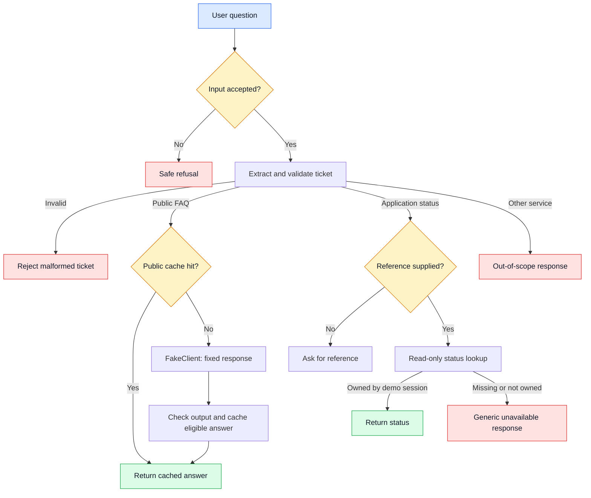

# Murshid Mini — Mona Alfayez

**LLM Application Engineering · SDA-AIE-213**

Murshid Mini is my small bilingual service-assistant learning project, built in one cumulative notebook over four days. It answers selected public questions, checks fictional application status through a controlled tool, and demonstrates validation, guardrails, testing, and caching.

> **What this project is:** The core runs in `mode=mock`. `FakeClient` is deterministic mock code that returns fixed responses; it is **not a trained or live language model**. This project demonstrates application engineering around a model-shaped interface. The separate Day 1 and Day 4 homework notebooks use a real local model for small experiments.

## 1. Problem and intended users

A service assistant must do more than produce fluent text. It needs to recognize a request, ask for missing information, control access to records, avoid unsupported actions, and show evidence that its behavior works. Murshid Mini is for learners practicing those engineering steps with safe, hand-written data. It is not a public service for real applicants.

## 2. Scope: what it does and does not do

| It does | It does not |
| --- | --- |
| Answer a known Arabic or English service FAQ with a fixed response | Answer arbitrary service questions reliably |
| Extract and validate a structured ticket | Use a live model in the core notebook |
| Look up fictional application status with a demo ownership check | Authenticate real users or access real records |
| Ask for a missing reference and refuse unsupported actions | Cancel or change an application |
| Test expected behavior and cache eligible public answers | Cache private status answers or provide production security |

The demo identity comes from a trusted test setup, not from words in the user's question. The status tool is read-only. Missing and unauthorized records receive the same outward response to avoid revealing whether a record exists.

## 3. Four-day development journey

All four core stages extend [the same notebook](notebooks/murshid_MonaAlfayez.ipynb).

| Day | Work added | Saved evidence |
| --- | --- | --- |
| 1 · Foundations | Synthetic FAQ directory, `FakeClient`, `ask()`, and a response contract | [Baseline results](results/core/baseline_results.json) |
| 2 · Structure and tools | Structured ticket, schema validation, read-only status lookup, and ownership check | [Day 2 results](results/core/day2_results.json) |
| 3 · Guardrails and tests | Controlled pipeline, input/output checks, and ten golden cases | [Day 3 results](results/core/day3_results.json) |
| 4 · Measure and finish | Public-answer cache, regression checks, metrics, and final export | [Day 4 results](results/core/day4_results.json) · [Final report](results/core/final_report.json) |

The optional exercises are separate notebooks: [Day 1 real model](homework/day1_real_model_MonaAlfayez.ipynb), [Day 2 tools](homework/day2_tools_MonaAlfayez.ipynb), [Day 3 errors](homework/day3_errors_MonaAlfayez.ipynb), and [Day 4 evaluation](homework/day4_evaluation_MonaAlfayez.ipynb).

## 4. Environment and fresh-runtime instructions

The **core** needs Python 3.9 or newer, a CPU runtime, and only Python's standard library. It needs no API key, paid API, GPU, package installation, or model download.

1. Open [`notebooks/murshid_MonaAlfayez.ipynb`](notebooks/murshid_MonaAlfayez.ipynb) in Google Colab.
2. Choose a Python 3 runtime with **CPU / no hardware accelerator**.
3. Restart the runtime, then run every cell from the top in order. Later cells depend on definitions from earlier days.
4. Check the printed assertions and results. Download generated JSON files before the Colab session ends and compare them with [the uploaded core results](results/core/).

Run each optional homework notebook separately using its own setup. The real-model exercises download packages and model weights and require internet access, but no paid inference API.

## 5. Synthetic dataset and field definitions

All examples are **hand-written synthetic teaching fixtures**, not government records or personal data. See [`synthetic_data.json`](results/core/synthetic_data.json).

| Field | Meaning |
| --- | --- |
| `service` | Ticket category: `service_info`, `application_status`, or `other` |
| `city` | Extracted city, or `unknown` when none is recognized |
| `request_id` | Optional reference in the format `REF-1234` |
| `needs_clarification` | Boolean indicating that a status request lacks a reference |
| `owner`, `status` | Fictional record owner and application state |

The fixture session is `demo-user-1`. `REF-1001` belongs to that user and is `under_review`; `REF-1002` belongs to `demo-user-2` and is `approved`. `REF-9999` is intentionally absent for a negative test. These identities are test fixtures, not real authentication.

## 6. Example inputs and expected behavior

| Input | Expected behavior |
| --- | --- |
| `كيف أتابع طلبي؟` | Return the fixed Arabic answer: `يمكنك متابعة حالة طلبك باستخدام رقم المرجع.` |
| `How can I check my application status?` | Return the fixed English answer: `You can check your application status using its reference number.` |
| `ما حالة REF-1001؟` | For `demo-user-1`, return `under_review` through the status tool |
| `ما حالة طلبي؟` | Ask for the reference number; make no status-tool call |
| `ما حالة REF-1002؟` | Do not reveal another user's status |
| `ألغ طلبي REF-1001` | Refuse the unsupported change; leave records unchanged |

## Workflow

## 7. Tests and measured results

[The core final report](results/core/final_report.json) records **10/10 selected golden cases passing**. These include the public FAQs, authorized and unauthorized status requests, missing information, out-of-scope input, a blocked instruction, blank input, and a malformed ticket. A correct refusal counts as a pass when the request should be refused.

In the controlled Day 4 cache experiment, three repeated public requests made **3 mock-client calls without the cache and 1 with it**. The cache-hit sequence was `false, true, true`, a **66.7% hit rate**. The core made **0 external inference API calls**. See [metrics](results/core/metrics.json) and [the final report](results/core/final_report.json). Timings and trace IDs vary between runs; illustrative cost calculations are not billed charges.

The [Day 4 real-model evaluation](homework/day4_evaluation_MonaAlfayez.ipynb) includes three questions, generated answers, tokenizer-measured token counts, execution time in seconds, and a manual review of each answer. Its [saved report](results/Day4/evaluation_result.json) shows **3/3 keyword hits**; this narrow indicator alone does not prove semantic correctness.

## 8. Limitations and future improvement

The core `FakeClient` only knows fixed answers. Rule-based extraction and pattern guards cover selected phrasings, not every possible question or attack. The demo ownership check is not a production authentication system. Ten mock tests and three similar English real-model questions cannot establish general accuracy, Arabic-language performance, or real-world safety.

Next, I would test more varied English and Arabic inputs, including unsupported questions, review each generated answer for meaning and unsupported claims, and add regression cases for edge conditions. A real service would also need proper authentication, privacy controls, broader evaluation, and operational testing.

## 9. Repository contents

- [Core notebook](notebooks/murshid_MonaAlfayez.ipynb): the cumulative Days 1–4 implementation.
- [Homework notebooks](homework/): four separate optional exercises.
- [Core results](results/core/): daily JSON outputs, synthetic data, metrics, and final report.
- [Day 1 real-model result](results/Day1/live_demo_result.json) and [Day 4 evaluation result](results/Day4/evaluation_result.json): optional homework evidence.

## 10. Program and attribution

Created by **Mona Alfayez as a student project** while learning **LLM Application Engineering · SDA-AIE-213**. **Meaad Al-Marri** is the course instructor. The course is delivered in the **SDAIA Academy** training context. Course materials: [Murshid Mini learning repository](https://github.com/almiyead-rgb/murshid-llm-application-engineering-sda-aie-213). [SDAIA Academy on GitHub](https://github.com/SDAIAAcademy).
